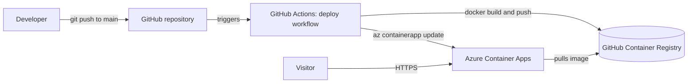

# shipit-app

[](https://github.com/rahimahisah17/shipit-app/actions/workflows/deploy.yml)


A tiny Python web app that is **containerised with Docker**, **published to GitHub Container Registry (GHCR)**, **deployed to Azure Container Apps** and **automatically redeployed by GitHub Actions on every push to `main`**.

I built it for the **ShipIt Weekend: Deploy Your First App to Azure** lab. The app itself is deliberately simple. The point of the project is the path from code to production: container, registry, cloud hosting, least-privilege access and a CI/CD pipeline.

> **Full write-up:** [From Zero to Live: Containerise a Python App, Deploy It to Azure Container Apps and Automate It with GitHub Actions](https://dev.to/rahimah_dev/from-zero-to-live-containerise-a-python-app-deploy-it-to-azure-container-apps-and-automate-it-4g9g) on DEV.to. It walks through every step, including the errors I hit and how I fixed them.

---

## Table of contents

- [What it does](#what-it-does)
- [Architecture](#architecture)
- [Tech stack](#tech-stack)
- [Repository structure](#repository-structure)
- [Prerequisites](#prerequisites)
- [Run it locally](#run-it-locally)
- [Publish the image to GHCR](#publish-the-image-to-ghcr)
- [Deploy to Azure Container Apps](#deploy-to-azure-container-apps)
- [The CI/CD pipeline](#the-cicd-pipeline)
- [Screenshots](#screenshots)
- [Troubleshooting](#troubleshooting)
- [Security notes](#security-notes)
- [Clean up](#clean-up)
- [Lessons learned](#lessons-learned)
- [Author](#author)

---

## What it does

`app.py` starts an HTTP server on port `8080` (or the port in the `PORT` environment variable) and answers every request with a small HTML page:

```html
<h1>Shipped automatically by GitHub Actions!</h1>
<p>Built with Docker, shipped to Azure, automated with GitHub Actions.</p>
```

The heading was originally "Hello from ShipIt Weekend!". I changed it as the final step so the pipeline had something new to build and deploy, which proved that a push to `main` reaches production without any manual Azure commands.

## Architecture



1. A push to `main` triggers the `deploy` workflow.
2. The workflow builds the Docker image and pushes it to GHCR, tagged with the first 7 characters of the commit ID.
3. The workflow signs in to Azure with a service principal and runs `az containerapp update`, which points the app at the new image.
4. Azure Container Apps pulls the image and serves it over a public HTTPS address.

## Tech stack

| Area | Technology |
|---|---|
| App | Python 3.12, standard library only (`http.server`) |
| Container | Docker (`python:3.12-slim`, runs as the unprivileged `nobody` user) |
| Registry | GitHub Container Registry (`ghcr.io`) |
| Hosting | Azure Container Apps (external ingress, port 8080) |
| CI/CD | GitHub Actions |
| Access | Azure service principal, scoped to a single resource group |

## Repository structure

```text
shipit-app/
├── .github/
│   └── workflows/
│       └── deploy.yml    # CI/CD pipeline: build, push, deploy
├── docs/
│   └── images/           # Screenshots used in this README
├── app.py                # The web server
├── Dockerfile            # How the image is built
└── README.md
```

### `app.py`

```python
import os
from http.server import BaseHTTPRequestHandler, HTTPServer

MESSAGE = "Shipped automatically by GitHub Actions!"


class Handler(BaseHTTPRequestHandler):
    def do_GET(self):
        body = f"<h1>{MESSAGE}</h1><p>Built with Docker, shipped to Azure, automated with GitHub Actions.</p>".encode()
        self.send_response(200)
        self.send_header("Content-Type", "text/html; charset=utf-8")
        self.send_header("Content-Length", str(len(body)))
        self.end_headers()
        self.wfile.write(body)


HTTPServer(("0.0.0.0", int(os.environ.get("PORT", "8080"))), Handler).serve_forever()
```

### `Dockerfile`

```dockerfile
FROM python:3.12-slim
WORKDIR /app
COPY app.py .
ENV PORT=8080
EXPOSE 8080
USER nobody
CMD ["python", "app.py"]
LABEL org.opencontainers.image.source=https://github.com/rahimahisah17/shipit-app
```

- `USER nobody` runs the app as a non-root user.
- The `LABEL` line links the image to a GitHub repository, so GitHub shows the package on the repo and lets the pipeline push new versions. It points at the repository's original name (`shipit`), which GitHub redirects to `shipit-app`.

## Prerequisites

- Git, with a GitHub account
- [Docker](https://docs.docker.com/get-docker/)
- Python 3.12 (only needed if you run the app without Docker)
- The [Azure CLI](https://learn.microsoft.com/cli/azure/install-azure-cli) and an Azure subscription (only for the deployment steps)

I ran everything from Ubuntu on WSL on a Windows laptop.

## Run it locally

```bash
git clone git@github.com:rahimahisah17/shipit-app.git
cd shipit-app

docker build -t shipit-app .
docker run -d --rm -p 8080:8080 --name shipit shipit-app
curl http://localhost:8080
docker stop shipit
```

| Command | What it does |
|---|---|
| `docker build -t shipit-app .` | Builds an image from the `Dockerfile` in this folder and names it `shipit-app`. |
| `docker run -d --rm -p 8080:8080 --name shipit shipit-app` | Starts the container in the background, deletes it when it stops, maps port 8080 to your machine and names it `shipit`. |
| `curl http://localhost:8080` | Fetches the page from the running container. |
| `docker stop shipit` | Stops the container (and, because of `--rm`, removes it). |

You can also run the app without Docker: `python app.py`.


## Publish the image to GHCR

Create a personal access token (classic) with only the `write:packages` scope, then log in, build, tag and push:

```bash
export GH_USER=rahimahisah17

echo YOUR_TOKEN | docker login ghcr.io -u $GH_USER --password-stdin
docker build -t ghcr.io/$GH_USER/shipit-app:v1 .
docker push ghcr.io/$GH_USER/shipit-app:v1
```

A new GHCR package is **private by default**. For Azure to pull it without credentials, change it to public: your profile → **Packages** → `shipit-app` → **Package settings** → **Danger Zone** → **Change visibility** → **Public**.


## Deploy to Azure Container Apps

```bash
az login --use-device-code
az extension add --name containerapp --upgrade
az provider register --namespace Microsoft.App --wait
az provider register --namespace Microsoft.OperationalInsights --wait

az group create --name shipit-rg --location westeurope

az containerapp up \
  --name shipit-app \
  --resource-group shipit-rg \
  --location westeurope \
  --image ghcr.io/$GH_USER/shipit-app:v1 \
  --ingress external \
  --target-port 8080
```

| Command | What it does |
|---|---|
| `az login --use-device-code` | Signs the CLI in using a code and a URL, which works well in WSL. |
| `az extension add --name containerapp` | Installs the extension that provides `az containerapp`. |
| `az provider register ... --wait` | Enables the services Container Apps needs (the app service and Log Analytics). A new subscription must do this once. |
| `az group create` | Creates a resource group, the container for everything in this project. |
| `az containerapp up` | Creates the Container Apps environment, a Log Analytics workspace and the app. `--ingress external` gives it a public address and `--target-port 8080` matches the port in the container. |

The first deployment can take more than five minutes. Don't interrupt it. When it finishes, get the public URL:

```bash
export APP_URL=https://$(az containerapp show --name shipit-app --resource-group shipit-rg --query properties.configuration.ingress.fqdn -o tsv)
curl $APP_URL
```


> **Live demo:** I deleted the Azure resource group after finishing the lab so nothing keeps costing money, so the public URL no longer responds. The screenshot below shows the app while it was live.


## The CI/CD pipeline

The workflow in [`.github/workflows/deploy.yml`](.github/workflows/deploy.yml) runs on every push to `main`, and can also be started manually (`workflow_dispatch`).

```yaml
name: deploy

on:
  push:
    branches: [main]
  workflow_dispatch:

permissions:
  contents: read
  packages: write

jobs:
  deploy:
    runs-on: ubuntu-latest
    steps:
      - uses: actions/checkout@v4

      - name: Log in to GitHub Container Registry
        uses: docker/login-action@v3
        with:
          registry: ghcr.io
          username: ${{ github.actor }}
          password: ${{ secrets.GITHUB_TOKEN }}

      - name: Build and push the image
        run: |
          IMAGE=ghcr.io/${GITHUB_REPOSITORY_OWNER,,}/shipit-app:${GITHUB_SHA::7}
          docker build -t "$IMAGE" .
          docker push "$IMAGE"
          echo "IMAGE=$IMAGE" >> "$GITHUB_ENV"

      - name: Log in to Azure
        uses: azure/login@v2
        with:
          creds: ${{ secrets.AZURE_CREDENTIALS }}

      - name: Deploy to Azure Container Apps
        run: az containerapp update --name shipit-app --resource-group shipit-rg --image "$IMAGE"
```

| Step | Purpose |
|---|---|
| Checkout | Gets the repository code onto the runner. |
| Log in to GHCR | Uses the temporary built-in `GITHUB_TOKEN`, so no personal token is stored in the pipeline. |
| Build and push | Builds the image and tags it with the short commit ID, so every deployment can be traced to a commit. |
| Log in to Azure | Signs in with the `AZURE_CREDENTIALS` secret. |
| Deploy | Runs `az containerapp update` to point the app at the new image. |

### One-time setup the pipeline needs

**1. Create a least-privilege service principal**, limited to the one resource group:

```bash
export SUB_ID=$(az account show --query id -o tsv)

az ad sp create-for-rbac \
  --name shipit-github \
  --role contributor \
  --scopes /subscriptions/$SUB_ID/resourceGroups/shipit-rg \
  --json-auth
```

**2. Save the JSON output as a repository secret** named `AZURE_CREDENTIALS`: **Settings** → **Secrets and variables** → **Actions** → **New repository secret**. The output contains a client secret, so never commit it or paste it anywhere public.

**3. Allow the repository to push to the package.** If the image was first pushed from your own machine, the workflow's `GITHUB_TOKEN` can't write to it until you grant access: open the package → **Package settings** → **Manage Actions access** → **Add Repository**, choose this repo and set the role to **Write**.


 |
## Troubleshooting

These are the real problems I hit while building this project.

| Problem | Cause | Fix |
|---|---|---|
| `echo $GH_USER` printed nothing | I opened a new terminal, and environment variables don't persist between sessions. | Run `export GH_USER=...` again. |
| Azure couldn't pull the image | GHCR packages are private by default. | Set the package visibility to **Public**. |
| `az containerapp up` looked stuck | Creating the environment and Log Analytics workspace takes several minutes. | Wait, and don't press Ctrl+C. |
| Pipeline failed with `denied: permission_denied: write_package` | The package was first pushed with my personal token, so the workflow's `GITHUB_TOKEN` had no write access to it. | Add the repository under **Manage Actions access** with the **Write** role, then re-run the workflow. |
| The credential claim said "couldn't reach your live URL" | My repository was named `shipit`, not the `shipit-app` the lab expected. | Rename the repository to `shipit-app` and use the matching URL. |
| `az login` showed yellow warnings | A harmless "attempted too soon" warning and a note about a tenant with no subscriptions. | Ignore them. The login still completes. |

After renaming a repository, update your local remote:

```bash
git remote set-url origin git@github.com:rahimahisah17/shipit-app.git
```

## Security notes

- **No secrets in code.** Azure credentials live in an encrypted GitHub secret, and the registry login uses a short-lived built-in token.
- **Least privilege.** The service principal can only manage one resource group, and the repository has write access to only one package.
- **Non-root container.** The image runs as `nobody` instead of root.
- **Short-lived tokens.** The personal access token used for the first push had a short expiry and was deleted afterwards.
- I blurred subscription IDs, tenant IDs and secrets in the article screenshots and did not include the screenshots that showed secrets in this repository.

A possible next step is replacing the stored service principal secret with **OpenID Connect (OIDC)**, which lets GitHub Actions sign in to Azure without a long-lived client secret.

## Clean up

Container Apps and Log Analytics can cost money if left running, so delete everything when you're done:

```bash
az group delete --name shipit-rg --yes --no-wait
az ad sp delete --id $(az ad sp list --display-name shipit-github --query "[0].id" -o tsv)
az group exists --name shipit-rg
```

| Command | What it does |
|---|---|
| `az group delete ... --no-wait` | Deletes the resource group and everything in it, and returns immediately while Azure finishes in the background. |
| `az ad sp delete ...` | Deletes the service principal. Deleting the resource group does not remove it. |
| `az group exists` | Prints `true` while the group still exists and `false` once the deletion has finished. |

Also delete the `AZURE_CREDENTIALS` repository secret and the personal access token. Note that once the resource group is gone, the `deploy` workflow will fail at the Azure step on future pushes.

## Lessons learned

- **Follow the naming in guided labs.** My `shipit` vs `shipit-app` mismatch caused the longest detour.
- **Read the failing step, not just the red X.** The Actions log named the exact problem: `write_package`.
- **Validation messages can mislead.** When a form's error doesn't make sense, re-check every input, not only the one the message mentions.
- **Clean up after yourself.** Deleting the resource group, service principal, secret and token leaves nothing running or exposed.

## Author

**Rahimah Sulayman**: [GitHub](https://github.com/rahimahisah17) | [DEV.to](https://dev.to/rahimah_dev)

If you try this project yourself, or have thoughts on handling Azure credentials in pipelines (secrets vs OIDC), I'd love to hear from you in the [article comments](https://dev.to/rahimah_dev/from-zero-to-live-containerise-a-python-app-deploy-it-to-azure-container-apps-and-automate-it-4g9g).
